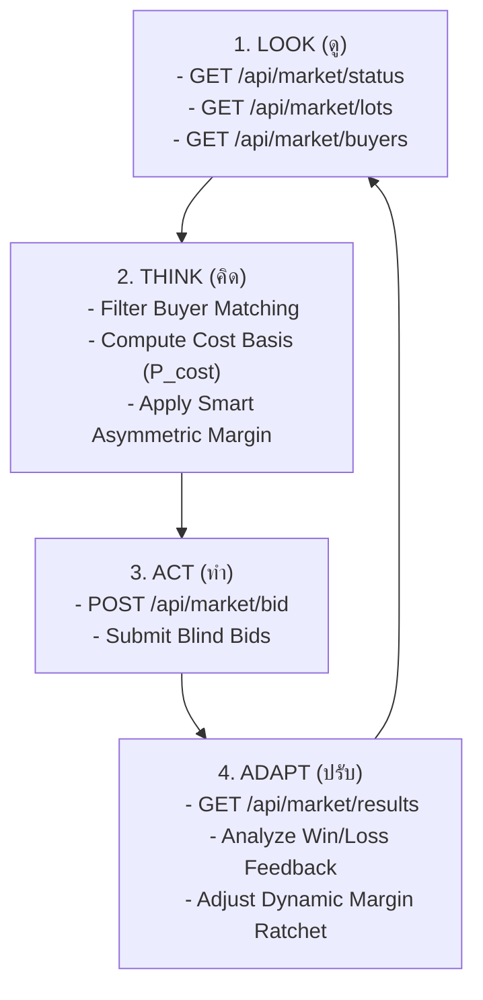

# 🤖 Track 3 Autonomous AI Trading Agent (The Next-Gen Market)

เอกสารสรุปกติกา สถาปัตยกรรม Algorithm และคู่มือการพัฒนาระบบ AI Trading Agent สำหรับการแข่งขัน **TESA Top Gun Rally #20 (2026) Track 3: The Next-Gen Market**

---

## 1. ข้อมูลสำคัญจากการอบรม Pre-Camp (Track 3)

| หัวข้อ | รายละเอียด |
| :--- | :--- |
| **รูปแบบการซื้อขาย** | **Blind Bidding (ประมูลปิดซอง)** ผ่าน REST API ไม่มีใครเห็นราคาประมูลของทีมอื่นในรอบนั้น |
| **สินค้าในตลาด** | เมล็ดกาแฟโรบัสตาชุมพร (Chumphon Robusta Coffee) แบ่งตาม Batch ID, เกรด, Defect Rate, และ Moisture % |
| **ผู้ซื้อในตลาด (Buyers)** | มีหลายกลุ่ม เช่น Specialty Roaster, Commercial Factory, Export Grade แต่ละกลุ่มมีเงื่อนไขความชื้น ($10.5\%-12.5\%$) และ Max Defect Rate ต่างกัน |
| **การเตรียมฮาร์ดแวร์ / GPU** | **ไม่ต้องนำ GPU มาเอง**: ผู้จัดมี API Endpoint และ LLM ให้บริการ พร้อม Starter Agent เริ่มต้น |
| **เกณฑ์คะแนน (Surplus Score)** | คำนวณจาก **Value Surplus Efficiency**: กำไรสะสมสุทธิจาก Lot ที่ชนะประมูลเทียบกับต้นทุนพื้นฐาน |

### กำหนดการแข่งขันจริง (Competition Timeline)
* **17 พ.ย. 2026 (20%):** Manual Trading Session — แข่งขันซื้อขายผ่าน Web Platform (มนุษย์ตัดสินใจ)
* **18 พ.ย. 2026 (30%):** AI Agent Trading Session — รัน Autonomous Agent แข่งขันในรอบจำลอง
* **20 พ.ย. 2026 (50%):** Final Tournament — แข่งขันจริงทุกทีมแบบ Real-time เต็มระบบ

---

## 2. วงลูปการทำงานของ AI Agent (Look $\rightarrow$ Think $\rightarrow$ Act $\rightarrow$ Adapt)

Agent ถูกออกแบบตามสถาปัตยกรรม 4 ขั้นตอนที่แนะนำโดยผู้จัด:



### รายละเอียดแต่ละขั้นตอน:
1. **LOOK (ดู):**
   * ตรวจสอบสถานะรอบการประมูล (`round_number`, `time_remaining`)
   * ดึงรายการ Lot กาแฟที่เปิดประมูล พร้อมผลวิเคราะห์จาก Track 1 (ความชื้น) และ Track 2 (Defect %)
   * ดึง Requirement และเพดานราคาของผู้ซื้อแต่ละราย
2. **THINK (คิด):**
   * **Rule-based Filter:** คัดกรอง Buyer ที่ Lot นั้นมีสเปกตรงตามเกณฑ์ (ถ้าความชื้นเกิน $12.5\%$ หรือ Defect เกินเกณฑ์ Buyer จะ Reject ทันที)
   * **Cost Basis:** คำนวณต้นทุน $P_{\text{cost}}$ ตามคุณภาพกาแฟ
   * **Strategic Pricing:** กำหนดราคาเสนอขาย $P_{\text{bid}} = P_{\text{cost}} \times (1 + \text{margin})$
3. **ACT (ทำ):**
   * ส่งคำเสนอซื้อ/ขายแบบ Blind Bid ผ่าน REST API Payload
4. **ADAPT (ปรับ):**
   * เมื่อรอบจบ ตรวจสอบผลว่า Lot ใด "ชนะ (Won)" หรือ "แพ้ (Lost)"
   * ถ้าแพ้บ่อย $\rightarrow$ ปรับลด Margin ลงเพื่อให้ชนะ
   * ถ้าชนะต่อเนื่อง $\rightarrow$ ขยับ Margin ขึ้นเพื่อเก็บ Surplus สูงสุด

---

## 3. กลยุทธ์การประมูล (Bidding Strategies)

ในโปรเจกต์นี้ ([`track3_market/strategy_benchmark.py`](file:///Users/sorn/TESA_2026/track3_market/strategy_benchmark.py)) ได้พัฒนาและเปรียบเทียบกลยุทธ์ไว้ 4 รูปแบบ:

| Strategy | คำอธิบาย | จุดเด่น | จุดด้อย |
| :--- | :--- | :--- | :--- |
| **1. Fixed Conservative** | บิด Margin ต่ำคงที่ ($8\% - 10\%$) | ชนะเกือบทุก Lot (Win Rate $\approx 95\%$) | กำไรต่อหน่วยต่ำ เสียโอกาสทำ Surplus สูง |
| **2. Fixed Aggressive** | บิด Margin สูงคงที่ ($22\% - 25\%$) | กำไรต่อ Lot สูงมากเมื่อชนะ | เสี่ยงแพ้ประมูลสูงมาก (Win Rate ต่ำ) |
| **3. Adaptive Feedback** | ปรับ Margin ตามผลลัพธ์ (ชนะ $+1\%$, แพ้ $-1.5\%$) | ยืดหยุ่นตามสภาพการแข่งขัน | ต้องใช้เวลาหลายรอบในการปรับตัว (Cold Start) |
| **4. Smart Asymmetric (Champion 🏆)** | ตั้ง Margin แบบไม่สมมาตรตามเกรด | **ทำ Surplus สูงสุดใน Benchmark**: เมล็ดเกรดธรรมดาบิดมาร์จิ้นสูง ($18\% - 25\%$) เมล็ดเกรดพรีเมียมบิดมาร์จิ้นบาง ($8\% - 12\%$) เพื่อล็อกชัยชนะ | มีความซับซ้อนในการคำนวณสัดส่วน |

### สูตร Smart Asymmetric Margin Formula
$$\text{Margin}(lot) = \text{BaseMargin} \times \left(1.0 + \frac{\text{DefectPct}}{100} \times 1.2\right) \times \left(\frac{P_{\text{max\_budget}}}{P_{\text{cost\_basis}}}\right)^{0.3}$$

---

## 4. โครงสร้าง REST API Data Contract (Mock & Organizer)

### 4.1 ดูสถานะตลาด (`GET /api/market/status`)
```json
{
  "round_id": 3,
  "status": "OPEN",
  "time_remaining_sec": 45,
  "active_buyers_count": 4,
  "available_lots_count": 12
}
```

### 4.2 รายการกาแฟ (`GET /api/market/lots`)
```json
[
  {
    "lot_id": "LOT-CPN-001",
    "batch_id": "CPN-2026-B001",
    "grade": "Grade 1",
    "defect_rate_pct": 3.2,
    "moisture_pct": 11.4,
    "primary_defects": 1,
    "secondary_defects": 3,
    "weight_kg": 500,
    "cost_basis_thb": 280.0
  }
]
```

### 4.3 ส่งคำประมูล (`POST /api/market/bid`)
```json
[
  {
    "lot_id": "LOT-CPN-001",
    "buyer_id": "buyer_specialty",
    "bid_price_thb": 322.0
  }
]
```

---

## 5. วิธีรันและทดสอบระบบ AI Trading Agent

### 5.1 รัน Mock Market Server ในเครื่อง
```bash
uv run python track3_market/mock_market_api.py
```
*API Docs เข้าดูได้ที่:* `http://localhost:8000/docs`

### 5.2 รัน AI Trading Agent เข้าเทรด
```bash
# รันกลยุทธ์ Smart Asymmetric (แนะนำสำหรับแข่งจริง)
uv run python track3_market/trading_agent.py --strategy asymmetric --rounds 10

# หรือรันกลยุทธ์ Adaptive
uv run python track3_market/trading_agent.py --strategy adaptive --rounds 10
```

### 5.3 รัน Tournament Benchmark ประลองทั้ง 4 กลยุทธ์
```bash
uv run python track3_market/strategy_benchmark.py --rounds 20 --lots-per-round 15
```

---

## 6. แผนการต่อเชื่อมกับ Starter Agent ของผู้จัดในวันแข่งจริง

เมื่อกรรมการแจกโค้ด Starter Agent และ API Key ในวันที่ 18 พ.ย.:
1. นำ Method `compute_bid_price(lot, buyer)` จาก [`track3_market/trading_agent.py`](file:///Users/sorn/TESA_2026/track3_market/trading_agent.py) ไปแทนที่ฟังก์ชันสุ่มราคาเดิมของ Starter Agent
2. ส่งผลวิเคราะห์ความชื้นจาก ESP32 (Track 1) และ Defect จาก Vision (Track 2) ผ่าน Data Contract ไปยัง `think()` stage
3. เปิดใช้งาน **Safety Check Constraints**: ดักจับไม่ให้ส่งราคาประมูลที่ต่ำกว่าต้นทุน หรือส่ง Lot ที่ความชื้นเกิน $12.5\%$ ให้ Buyer เด็ดขาด
