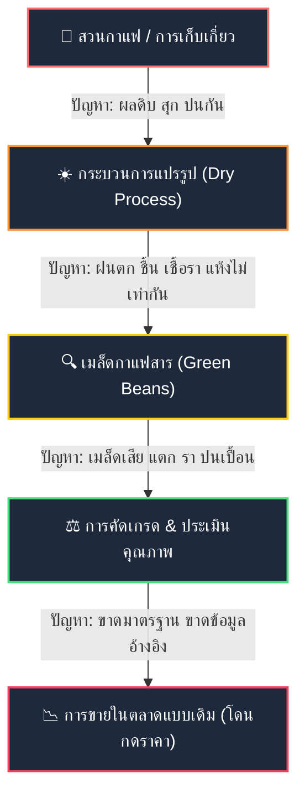
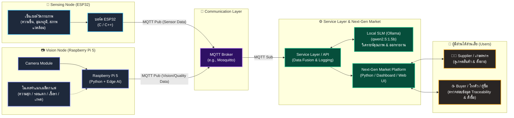

# แผนภาพและภาพรวมระบบ TESA Top Gun Rally ครั้งที่ 20 (TGR2026)
**หัวข้อ:** แพลตฟอร์ม AIoT เพื่อขับเคลื่อนกาแฟโรบัสตาชุมพรสู่ตลาดยุคใหม่  
*(Chumphon Robusta AIoT Platform Toward The Next-Gen Market)*

---

## 1. บริบทและปัญหาที่ต้องแก้ไข (Pain Points & Domain Context)



* **เป้าหมายของการแข่งขัน:** สร้างระบบ AIoT ที่สามารถ **ตรวจวัด (Sensing) $\rightarrow$ ประมวลผลภาพ (Vision AI) $\rightarrow$ รวบรวมข้อมูล (Data Integration) $\rightarrow$ ประเมินคุณภาพและจับคู่ซื้อขายในตลาดใหม่ (The Next-Gen Market + SLM)** เพื่อสร้างมูลค่าเพิ่ม (Value-added) ให้กาแฟโรบัสตาชุมพร

---

## 2. แผนภาพสถาปัตยกรรมระบบรวม (End-to-End System Architecture)



---

## 3. รายละเอียดการทำงานของแต่ละส่วน (Component Breakdown)

| องค์ประกอบ | เทคโนโลยี / อุปกรณ์ | หน้าที่หลัก | สิ่งที่ต้องพัฒนา |
| :--- | :--- | :--- | :--- |
| **1. Sensing Node** | **ESP32** (ภาษา C/C++) | ตรวจวัดค่าทางกายภาพของเมล็ดหรือกระบวนการตาก/เก็บ | • อ่านค่าจากเซ็นเซอร์ (Digital/Analog/PWM)<br/>• ส่งข้อมูลผ่าน Wi-Fi เข้า MQTT Broker |
| **2. Vision Node** | **Raspberry Pi 5** (Python) *(ห้ามใช้ AI Hat)* | ตรวจสอบคุณภาพเมล็ดกาแฟทางกายภาพ (เมล็ดดี, เมล็ดดำ, เชื้อรา, เมล็ดแตก) | • รัน Computer Vision (OpenCV / ONNX / YOLO)<br/>• สรุปผลนับจำนวน/คัดเกรด ส่งเข้า MQTT |
| **3. Broker & Service** | **MQTT Broker** + **Python Backend** | เป็นทางด่วนข้อมูลและจัดการ Data Pipeline | • จัดหัวข้อ (Topics) และโครงสร้าง JSON Payload<br/>• ผสานข้อมูลสภาพแวดล้อม + ผลตรวจภาพเข้ากับ Batch ID |
| **4. Local SLM** | **Ollama (`qwen2.5:1.5b`)** | วิเคราะห์และให้คำแนะนำด้วยภาษาธรรมชาติ | • ประเมินเกรดกาแฟพร้อมคำแนะนำการคั่ว/แปรรูป<br/>• สร้างรายงานคุณภาพ (Traceability Profile) แบบอัตโนมัติ |
| **5. Next-Gen Market** | **Python (Streamlit / FastAPI)** | แพลตฟอร์มตลาดซื้อขายผลผลิตกาแฟตามคุณภาพจริง | • หน้าจอสำหรับ Supplier อัปโหลดข้อมูลขาย<br/>• หน้าจอสำหรับ Buyer เลือกดูโปรไฟล์กาแฟและสั่งซื้อ |
| **6. System Integration** | **End-to-End System** | เชื่อมทุกส่วนเข้าด้วยกันแบบไร้รอยต่อ | • รับมือโจทย์พิเศษ (Surprise Special Problem) ระหว่างแข่ง |

---

## 4. แผนกลยุทธ์การแบ่งทีม 5 คน (Team Roles & Responsibilities)

เพื่อให้ทำงานทันตามกำหนดการแข่งขัน 7 วัน ควรแบ่งบทบาทของสมาชิกทั้ง 5 คนให้ชัดเจน:

```mermaid
mindmap
  root((ทีม 5 คน))
    (Member 1: Embedded Specialist)
      ESP32 Firmware
      การต่อวงจรเซ็นเซอร์
      MQTT Client บน ESP32
    (Member 2: Edge AI & Vision)
      Raspberry Pi 5 Setup
      Camera & Image Preprocessing
      Computer Vision / Classification Model
    (Member 3: Backend & Data Integration)
      MQTT Broker Setup
      Data Pipeline & API Service
      ผสานข้อมูล Sensor + Vision เข้า Database
    (Member 4: SLM & Market Platform)
      Ollama Integration (qwen2.5:1.5b)
      Prompt Engineering สรุปเกรดกาแฟ
      Web Dashboard / Market Platform (Streamlit/FastAPI)
    (Member 5: Project Lead & Integration)
      ภาพรวมระบบ (System Architecture)
      ควบคุม Time Tracking & โจทย์รายวัน
      เตรียมการสาธิต (Live Demo) & พรีเซนต์
```

---

## 5. ลำดับเวลาการแข่งขัน (Competition Timeline)

* **15 พ.ย. 2569:** เข้าที่พัก / Setup ระบบและทดสอบอุปกรณ์
* **16 พ.ย. 2569:** พิธีเปิด + บรรยายโจทย์ + อบรม Project Management + ศึกษาดูงานศูนย์เกษตร
* **17 พ.ย. 2569 (วันแข่งที่ 1):** อบรมแยก 3 ห้อง $\rightarrow$ รับโจทย์รายวัน $\rightarrow$ ทำโจทย์และส่งงาน 17:00 น.
* **18 พ.ย. 2569 (วันแข่งที่ 2):** อบรมต่อช่วงเช้า $\rightarrow$ รับโจทย์ยกระดับ $\rightarrow$ ส่งงาน 17:00 น. (ลุ้น Daily Top Score)
* **19 พ.ย. 2569 (วันแข่งที่ 3):** รับโจทย์ **System Integration** เชื่อมทุกส่วนเข้าด้วยกัน + **Surprise Problem**
* **20 พ.ย. 2569 (วันแข่งที่ 4):** Final Touch ผลงาน + ซ้อมพรีเซนต์ $\rightarrow$ นำเสนอต่อหน้ากรรมการ (Presentation)
* **21 พ.ย. 2569 (วันสุดท้าย):** **Live Demonstration** $\rightarrow$ พิธีมอบรางวัลและปิดงาน

---

## 6. สิ่งที่ต้องเตรียมไปแข่งขัน (Preparation & Packing Checklist)
> 💡 **แผนเตรียมตัวแบบเจาะลึก 6 มิติ (ฉบับจัดเต็ม):** สามารถดูคู่มือและโค้ดตัวอย่างได้ที่ [ULTIMATE_PREPARATION_CHECKLIST.md](file:///Users/sorn/TESA_2026/ULTIMATE_PREPARATION_CHECKLIST.md)

### 6.1 อุปกรณ์ตามกติกาบังคับ (Mandatory Requirements)
* [ ] **เครื่องคอมพิวเตอร์พกพา (Notebook):**
  * สมาชิกในทีมทุกคนควรมีโน้ตบุ๊กประจำตัว
  * **อย่างน้อย 1 เครื่อง** ต้องมีสเปกที่สามารถรัน **Local SLM ขนาด 1.5B** ได้ลื่นไหล เช่น Ollama `qwen2.5:1.5b` (Core i5/Ryzen 5 + RAM 16GB + GPU GTX 1650/RTX หรือ MacBook Apple Silicon M-Series)
* [ ] **บอร์ด ESP32:**
  * รองรับ Wi-Fi และ Pin I/O (Digital, Analog, PWM)
  * *(แนะนำ)* เตรียมไปอย่างน้อย **2-3 บอร์ด** (สำหรับใช้งานจริงและเป็นตัวสำรองกรณีบอร์ดช็อตหรือเสียหาย)
* [ ] **บอร์ด Raspberry Pi 5:**
  * ใช้สำหรับรัน Vision Node & Edge AI
  * **⚠️ ข้อห้ามตามกติกา:** ไม่อนุญาตให้ใช้ AI Hardware Extension Board ในรูปแบบ AI HAT+ หรืออื่นๆ
* [ ] **ปลั๊กพ่วง (Power Strip):**
  * รางปลั๊กพ่วงสายยาวอย่างน้อย 3–5 เมตร ได้มาตรฐาน มอก. พร้อมช่องเสียบเพียงพอสำหรับโน้ตบุ๊ก 5 เครื่องและอุปกรณ์บอร์ดทดลอง

---

### 6.2 อุปกรณ์เสริมฮาร์ดแวร์ที่ต้องเตรียมไปเอง (Hardware & Accessories)
* [ ] **แหล่งจ่ายไฟ Raspberry Pi 5:** Adapter จ่ายไฟ Official 27W USB-C (5V/5A) เพื่อป้องกันปัญหาไฟตก (Under-voltage) ขณะรันโมเดล AI
* [ ] **กล้องสำหรับ Raspberry Pi 5:**
  * Raspberry Pi Camera Module 3 หรือ USB Webcam ความละเอียดสูง
  * **สายเคเบิล FPC สำหรับกล้อง RPi 5** (หัวขนาดเล็กพิเศษ 22-pin to 15-pin แตกต่างจาก RPi 4)
  * ขาตั้งกล้องขนาดเล็ก หรืออุปกรณ์ยึดจับสำหรับปรับมุมมองส่องเมล็ดกาแฟ
* [ ] **MicroSD Card & Card Reader:**
  * MicroSD Card ความเร็วสูง (UHS-I U3 / A2 / V30) ขนาด 32GB – 64GB ขึ้นไป อย่างน้อย **2 ใบ** (ใบหลัก + สำรอง Image)
  * MicroSD Card Reader แบบ USB สำหรับ Flash ข้อมูล
* [ ] **สายเชื่อมต่อและหัวแปลง (สำคัญมากสำหรับผู้ใช้ MacBook):**
  * **USB-C Multi-port Hub:** มีพอร์ต USB-A อย่างน้อย 2-3 ช่อง, ช่อง LAN RJ45, และช่อง Card Reader
  * **สาย Data USB:** สาย USB-C to USB-C หรือ USB-A to Micro-USB/Type-C (ตรวจสอบว่าเป็นสายส่งข้อมูลจริง ไม่ใช่แค่สายชาร์จ) สำหรับ Flash โค้ดลง ESP32
  * **สาย LAN (Ethernet Cable):** อย่างน้อย 1–2 เส้น สำหรับต่อตรงระหว่างโน้ตบุ๊กกับ Raspberry Pi 5 เพื่อ SSH เข้าใช้งานในกรณี Wi-Fi หน้างานมีปัญหา
* [ ] **อุปกรณ์งานช่างอิเล็กทรอนิกส์พื้นฐาน:**
  * Breadboard (โพรโทบอร์ด) ขนาดเล็ก-กลาง
  * สาย Jumper Wire (ผู้-ผู้, ผู้-เมีย, เมีย-เมีย) อย่างละ 1 ชุด
  * มัลติมิเตอร์วัดไฟ / คีมตัดสายไฟ / เทปพันสายไฟ
  * กล่องหรือเคสใส่บอร์ด ป้องกันการลัดวงจรหน้างาน

---

### 6.3 การเตรียมความพร้อมด้านซอฟต์แวร์ (Pre-install Software & Models)
*ดาวน์โหลดและติดตั้งให้เรียบร้อยตั้งแต่ก่อนเดินทางเพื่อหลีกเลี่ยงปัญหาอินเทอร์เน็ตหน้างาน:*
* [ ] **Local SLM:**
  * ติดตั้ง Ollama และรันคำสั่งดาวน์โหลดโมเดลล่วงหน้า: `ollama pull qwen2.5:1.5b`
  * ทดสอบการเรียกใช้งานผ่าน Python script สำเร็จ
* [ ] **Raspberry Pi OS:**
  * Flash Raspberry Pi OS (64-bit) ลง MicroSD Card ไว้ล่วงหน้า
  * เปิดใช้งาน SSH, เซ็ต User/Password และตั้งค่า Wi-Fi Hotspot มือถือไว้สำรอง
* [ ] **AI & Vision Packages:**
  * ติดตั้ง OpenCV, Ultralytics (YOLO), ONNX Runtime, TFLite บนเครื่องทดสอบและ RPi 5
* [ ] **Development Tools:**
  * VS Code พร้อม Extension: PlatformIO IDE, Python, Remote - SSH
  * MQTT Broker (Mosquitto) และโปรแกรมทดสอบ MQTT Explorer
  * ไลบรารี Python: `paho-mqtt`, `fastapi`, `streamlit`, `pandas`, `uvicorn`

---

### 6.4 สิ่งที่ผู้จัดเตรียมไว้ให้หน้างาน (Provided by Organizer)
* [x] **เซ็นเซอร์สำหรับ ESP32:** ทางโครงการจัดเตรียมให้ในวันแข่งขัน
* [x] **ที่พักและอาหาร:** ตลอดช่วงค่าย 6 วัน (16 – 21 พ.ย. 2569) สำหรับนักศึกษา

---

### 6.5 เอกสารและของใช้ส่วนตัว (Logistics & Personal Items)
* [ ] บัตรประจำตัวประชาชน / บัตรประจำตัวนักศึกษา
* [ ] หลักฐานการสมัครและหลักฐานการชำระเงินค่าลงทะเบียน
* [ ] เสื้อทีม / เสื้อผ้าสุภาพสำหรับพิธีเปิดและวันนำเสนอผลงาน (พิธีปิดใส่เสื้อ TGR2026)
* [ ] ยารักษาโรคประจำตัว และของใช้ส่วนตัวสำหรับการพักค้างแรม 7 วัน (15–21 พ.ย. 69 ณ มจล. ชุมพร)

