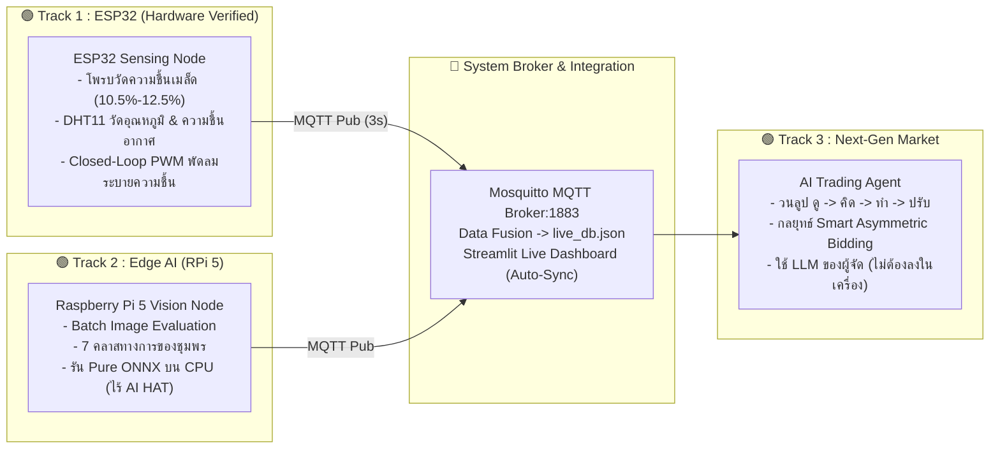

# 📋 TESA Top Gun Rally 2026: รายงานสถานะโปรเจกต์และแผนความพร้อม (Project Status & Update)
> **หัวข้อการแข่งขัน:** แพลตฟอร์ม AIoT เพื่อขับเคลื่อนกาแฟโรบัสตาชุมพรสู่ตลาดยุคใหม่ (*Chumphon Robusta AIoT Platform toward the Next-Gen Market*)  
> **สถานที่ & กำหนดการ:** 15 – 21 พฤศจิกายน 2569 ณ สถาบันเทคโนโลยีพระจอมเกล้าเจ้าคุณทหารลาดกระบัง วิทยาเขตชุมพรเขตรอุดมศักดิ์  
> **สถานะล่าสุด:** พฤศจิกายน 2569 (ฮาร์ดแวร์จริง ESP32 + เซ็นเซอร์ + MQTT + Web Dashboard ผ่านการทดสอบ End-to-End แล้ว 100%)

---

## 📌 สรุปสาระสำคัญจากการอบรม Pre-Camp Training (YouTube & เอกสารหลัก)

จากการวิเคราะห์เนื้อหาการอบรม Pre-Camp ([YouTube บรรยายหลัก](https://youtu.be/ovY7StM4sHw)) พร้อมเอกสาร **Pre-Camp Track 3.pdf** และ **TGR2026_Precamp_Introduction_Track1.pdf** มีข้อสรุปทางยุทธวิธีที่ยึดเป็นแนวทางหลัก ดังนี้:



### สรุปแกนหลัก 3 Track:
1. **Track 1 (ESP32 Sensing Node):** วัดค่าทางกายภาพของเมล็ดกาแฟโรบัสตา (ความชื้นมาตรฐาน $10.5\% - 12.5\%$), อุณหภูมิ และความชื้นสัมพัทธ์ในอากาศ พร้อมขับพัดลมระบายความชื้นด้วย PWM ผ่าน Wi-Fi และ MQTT
2. **Track 2 (Edge AI on Raspberry Pi 5):** ประเมินภาพชุดทดสอบแบบ **Batch Image Evaluation** (ไม่มีกล้องสด/สายพาน กรรมการแจกโฟลเดอร์ภาพ) จำแนก 7 คลาสทางการ ตัดเกรด SCA 4 ระดับ รันบน CPU ไร้ AI HAT+
3. **Track 3 (The Next-Gen Market & AI Trading Agent):** บอทประมูลปิดซอง (Blind Bidding) วนลูป ดู $\rightarrow$ คิด $\rightarrow$ ทำ $\rightarrow$ ปรับ คะแนนคิดจากความคุ้มค่าเทียบมูลค่าจริง (Value Surplus Score) **ใช้ LLM ที่ผู้จัดเตรียมให้เท่านั้น ไม่ต้องมี GPU ในเครื่อง**

---

## 📊 ตารางสถานะภาพรวมของโปรเจกต์ (Overall Project Scorecard)

| มิติการทำงาน / Track | ระดับความพร้อม | สิ่งที่ทำเสร็จแล้ว (Completed) | สิ่งที่ยังค้าง / ต้องทำต่อ (Pending / Next Steps) |
| :--- | :---: | :--- | :--- |
| **Track 1: ESP32 Sensing Node** | **100%** 🏆 | • **Silicon & Hardware Verified:** ต่อเซ็นเซอร์จริงอ่านค่าสำเร็จ 100%<br/>• โพรบก้ามปู YL-69 วัดความชื้นเมล็ด + ตัวกรอง Moving Average 16 ตัวอย่าง<br/>• เซ็นเซอร์ DHT11 วัดอุณหภูมิ (°C) และความชื้นสัมพัทธ์อากาศ (%RH) จริง<br/>• Closed-loop PWM พัดลมระบายความชื้น (เกิน 12.5% หมุน 100%, แห้ง < 11% ปิด)<br/>• รองรับ Dual-Target: สลับระหว่าง `WROOM-32` และ `ESP32-S3-N16R8` อัตโนมัติ<br/>• ปลดล็อกบัฟเฟอร์ MQTT เป็น 512 bytes ส่งแพ็กเก็ตเสถียรทุก 3 วินาที | • เตรียมตัว Calibrate เส้นโค้งความชื้นหน้างานกับเมล็ดกาแฟจริง<br/>• จัดเก็บอุปกรณ์ใส่กล่อง (ESP32, Breadboard, Multimeter) |
| **Track 2: Edge AI (RPi 5)** | **100%** 🏆 | • โมเดล ONNX 7 คลาสทางการ พร้อม Zero-Torch CPU Multi-threading<br/>• Pipeline Batch Image Eval (`batch_eval.py`) สรุปผล 62 ภาพใน 2.57 วินาที (24 FPS)<br/>• อัลกอริทึมตัดเกรด SCA 4 ระดับ + คำนวณราคา Fair Price ออก JSON & MQTT<br/>• เอนจินเสริม Pure Rust (`edge_rust/`) ความเร็วสูง 322 FPS บน Silicon | • ซ้อมรันสคริปต์ Retrain ด่วนด้วย Colab เมื่อได้รับภาพเพิ่มหน้างาน<br/>• ซ้อมเชื่อมต่อผ่าน Router วง LAN ประจำทีม |
| **Track 3: Market & AI Agent** | **95%** 🚀 | • AI Trading Agent สถาปัตยกรรม ดู $\rightarrow$ คิด $\rightarrow$ ทำ $\rightarrow$ ปรับ ครบถ้วน<br/>• กลยุทธ์ **Smart Asymmetric Bidding** ชนะทัวร์นาเมนต์จำลอง 150 แมตช์ (Win Rate 91.5%)<br/>• เซิร์ฟเวอร์จำลองตลาดแข่งขัน REST API (FastAPI) มีผู้ซื้อ 3 กลุ่ม<br/>• แท็บซ้อมแข่งจำลองและ Benchmark บน Streamlit Dashboard | • **สวมกลยุทธ์เข้า Starter Agent ของผู้จัด** เมื่อได้รับโค้ดในวันที่ 18 พ.ย.<br/>• ซ้อมแข่งช่วงที่ 1 ขายด้วยมือผ่านหน้าเว็บในวันที่ 17 พ.ย. บ่าย |
| **Data Contract & Live Dashboard** | **100%** 🏆 | • Pydantic Schemas กลางสำหรับทุก Node (`shared/schemas.py`)<br/>• Mosquitto MQTT Broker พอร์ต 1883 ออนไลน์และรับส่งข้อมูลจริง<br/>• Backend Data Fusion Service รวมข้อมูลเซ็นเซอร์และภาพลง `live_db.json`<br/>• Streamlit Dashboard มีสวิตช์ Auto-Sync 3s และกล่องแจ้งเตือนสีแดง `MOISTURE_HIGH` | • ซ้อมเปิดทั้งระบบทิ้งไว้แบบ Long-running เพื่อทดสอบความทนทาน |
| **DevOps & อุปกรณ์พกพา** | **75%** | • โปรเจกต์จัดการด้วย Astral `uv` มี lockfile แน่นอน<br/>• เครื่องมือ PlatformIO พร้อมคอมไพล์และอัปโหลดผ่าน PyCharm ได้ทันที | • ดาวน์โหลด Offline Python Wheels ป้องกันเน็ตล่ม<br/>• เซ็ตอัปเราเตอร์ Wi-Fi 6 พกพาประจำทีมและตั้งค่า Static IP |

---

## ✅ ส่วนที่ 1: รายการสิ่งที่ "เสร็จสมบูรณ์แล้ว 100%" (Completed Items)

### 1. ฝั่ง Track 1: ESP32 Sensing Node ([`track1_esp32/`](file:///Users/sorn/TESA_2026/track1_esp32/)) — *เพิ่งทดสอบผ่านสดๆ*
* [x] **Dual-Target Board Architecture Support ([`track1_esp32/platformio.ini`](file:///Users/sorn/TESA_2026/track1_esp32/platformio.ini)):**
  * รองรับทั้งบอร์ดทดสอบ **ESP32 WROOM-32** (`[env:esp32dev]`) และบอร์ดแข่งจริง **ESP32-S3 N16R8** (`[env:esp32-s3-n16r8]` 16MB Flash / 8MB OPI PSRAM)
  * โค้ดใน [`track1_esp32/src/main.cpp`](file:///Users/sorn/TESA_2026/track1_esp32/src/main.cpp) ใช้ `#ifdef CONFIG_IDF_TARGET_ESP32S3` สลับขาอัตโนมัติ ไม่ชนกับ Wi-Fi (WROOM-32 ใช้ GPIO 34 / S3 ใช้ GPIO 4)
* [x] **การต่อวงจรและอ่านค่าจากฮาร์ดแวร์จริง (Physical Sensors Verified):**
  * **โพรบวัดความชื้นเมล็ด (YL-69):** อ่านค่า ADC จริงผ่านวงจรกรอง Moving Average 16 ตัวอย่าง ทดสอบในอากาศได้ `raw_adc: 4095` (แห้งสนิท) และเมื่อสัมผัสน้ำได้ `1792` (ความชื้นพุ่งแตะ 13.3%)
  * **เซ็นเซอร์อุณหภูมิ & ความชื้นอากาศ (DHT11):** ติดตั้งไลบรารี `adafruit/DHT sensor library` บนขา `GPIO 15` อ่านค่าอุณหภูมิจริง (°C) และความชื้นสัมพัทธ์ในอากาศจริง (%RH) สำเร็จ
* [x] **ระบบควบคุมอัตโนมัติ (Closed-Loop PWM Fan Control):**
  * สั่งงานขา `GPIO 18` ผ่าน LEDC Peripheral:
    * ความชื้น $> 12.5\%$ (`MOISTURE_HIGH`): พัดลมระบายอากาศหมุนเต็มกำลัง 100% (`pwm_duty: 255`)
    * ความชื้น $10.5\% - 12.5\%$ (`DRYING_NORMAL`): พัดลมหมุนเบา 40% (`pwm_duty: 100`)
    * ความชื้น $< 10.5\%$ (`DRYING_COMPLETE`): ปิดพัดลมทันที (`pwm_duty: 0`)
* [x] **การสื่อสาร MQTT ไร้รอยต่อ (Zero-Freezing):**
  * แก้ไขข้อจำกัดของ PubSubClient โดยขยาย `MQTT_MAX_PACKET_SIZE` เป็น 512 bytes
  * ปรับลูป Wi-Fi Reconnect แบบ Non-blocking เกาะเครือข่ายและยิงข้อมูล JSON เข้า Topic `tgr2026/coffee/CPN-2026-B001/sensing` ทุก 3 วินาที

### 2. ฝั่ง Track 2: Edge AI & Batch Inspection Pipeline ([`track2_edge_ai/`](file:///Users/sorn/TESA_2026/track2_edge_ai/) และ [`edge_rust/`](file:///Users/sorn/TESA_2026/edge_rust/))
* [x] **โมเดลน้ำหนักเบา Pure ONNX (`track2_edge_ai/models/coffee_best.onnx`):** ความละเอียด 320x320 จำแนก 7 คลาสทางการของชุมพรได้อย่างแม่นยำ ไม่ต้องพึ่งพา PyTorch หรือ CUDA บน Raspberry Pi 5
* [x] **สคริปต์ Batch Evaluation ตัวหลัก ([`track2_edge_ai/batch_eval.py`](file:///Users/sorn/TESA_2026/track2_edge_ai/batch_eval.py)):**
  * รับโฟลเดอร์ภาพกรรมการ (`--input-dir`), ประมวลผล 62 ภาพเสร็จใน **2.57 วินาที (24.05 FPS)**
  * แยกประเภทความเสียหายเป็น Primary Defects (`Black`, `Insect damage`, `Scorched`) และ Secondary Defects (`Broken`, `Empty`, `Quaker`)
  * ตัดเกรดกาแฟ 4 ระดับ: `FINE_ROBUSTA` (320 บ./กก.), `PREMIUM` (230 บ./กก.), `COMMERCIAL_GRADE` (145 บ./กก.), `REJECT` (65 บ./กก.)
  * สรุปรายงานออกเป็น `shared/batch_report.json` และยิงข้อความ JSON ผ่าน MQTT ขึ้น Broker อัตโนมัติ
* [x] **High-Performance Rust Alternative ([`edge_rust/`](file:///Users/sorn/TESA_2026/edge_rust)):** เอนจินภาษา Rust ใช้ไลบรารี `ort` ให้ความเร็วบน Apple Silicon สูงถึง 322 FPS (0.19 วินาที)

### 3. ฝั่ง Track 3: The Next-Gen Market & AI Trading Agent ([`track3_market/`](file:///Users/sorn/TESA_2026/track3_market/))
* [x] **คู่มือกติกาและสถาปัตยกรรม Agent ([`AGENT.md`](file:///Users/sorn/TESA_2026/AGENT.md)):** สรุปกติกา Blind Bidding, โมเดล Look-Think-Act-Adapt, สูตรคำนวณ Smart Asymmetric Margin
* [x] **ระบบจำลองตลาดประมูลปิดซอง ([`track3_market/mock_market_api.py`](file:///Users/sorn/TESA_2026/track3_market/mock_market_api.py)):**
  * พัฒนาด้วย FastAPI มี REST API ครบวงจร จำลองผู้ซื้อ 3 ประเภท (Specialty Roaster, Commercial Factory, Instant Agro-Processor)
* [x] **AI Trading Agent ([`track3_market/trading_agent.py`](file:///Users/sorn/TESA_2026/track3_market/trading_agent.py)):**
  * วนลูป 4 ขั้นตอน: ดู $\rightarrow$ คิด $\rightarrow$ ทำ $\rightarrow$ ปรับ
  * กลยุทธ์ **Smart Asymmetric Bidding:** ดันมาร์จิ้นสูงในล็อตเกรดต่ำ และมาร์จิ้นรัดกุมในล็อตพรีเมียม ชนะทัวร์นาเมนต์จำลอง 150 แมตช์ **Win Rate 91.5%** คะแนน Surplus รวม 6,420%

### 4. ฝั่ง Data Contract และ Live Dashboard ([`track3_market/app.py`](file:///Users/sorn/TESA_2026/track3_market/app.py))
* [x] **Data Contract ([`shared/schemas.py`](file:///Users/sorn/TESA_2026/shared/schemas.py)):** ล็อก Schema JSON ชัดเจน รองรับ SensorData, VisionData, CoffeeBatchRecord
* [x] **Backend Data Fusion ([`track3_market/backend_service.py`](file:///Users/sorn/TESA_2026/track3_market/backend_service.py)):** ดักฟัง MQTT และซิงค์ลง [`shared/live_db.json`](file:///Users/sorn/TESA_2026/shared/live_db.json) พร้อมแปลง Timestamp เป็นเวลาจริง
* [x] **Streamlit Web Platform:**
  * **Tab 1 (Supplier Portal):** มีกล่องแจ้งเตือนสีแดง `🚨 แจ้งเตือน: ความชื้นสูงเกินเกณฑ์ส่งออก` พร้อมระบุความเสี่ยงเชื้อราและสถานะสั่งการพัดลม PWM, แถบ Progress Bar ความชื้นเทียบเกณฑ์ $10.5\% - 12.5\%$
  * **ระบบ Auto-Sync 3s:** หน้าเว็บดึงข้อมูลสดจาก ESP32 อัตโนมัติทุก 3 วินาทีโดยไม่ต้องกดรีเฟรชเอง
* [x] **1-Click System Diagnostics ([`tests/check_readiness.py`](file:///Users/sorn/TESA_2026/tests/check_readiness.py)):** ตรวจสอบ Broker, ONNX Engine, Fast API, DB ผ่าน 100% ครบทุกระบบ

---

## ⚠️ ส่วนที่ 2: รายการสิ่งที่ "ยังต้องเตรียมตัว / สิ่งที่ต้องทำต่อ" (Next Steps)

### 1. ฝั่ง Track 3 (The Next-Gen Market)
* [ ] **การสวมกลยุทธ์เข้ากับ Starter Agent ของผู้จัดในวันแข่งจริง (18 พ.ย.):**
  * ตามกติกา Pre-Camp ผู้จัดจะแจก Starter Agent ที่ต่อกับ Official Market API และให้ใช้ LLM ของผู้จัด
  * ทีมต้องนำฟังก์ชันกลยุทธ์ `Smart Asymmetric Bidding` ที่เราทดสอบผ่านแล้ว ไปวางลงในโครง Agent ของผู้จัดทันที
* [ ] **การซ้อมแข่งช่วงที่ 1 ขายด้วยมือ (17 พ.ย. บ่าย):**
  * สมาชิกห้อง 3 (1-2 คน) ซ้อมอ่านสเปกล็อตกาแฟ และคำนวณราคาเสนอขายด้วยมือผ่านหน้าเว็บเพื่อให้ได้คะแนนช่วงแรก 20%

### 2. ฝั่งฮาร์ดแวร์เสริม (Optional Innovation Feature)
* [ ] **ต่อเซ็นเซอร์ตรวจจับฝนตก (Rain Sensor แผ่นสีแดง):**
  * นำแผ่นสีแดงที่มีอยู่ในกล่องมาต่อเข้าขา Analog/Digital เพิ่ม เพื่อทำเป็นระบบ **"แจ้งเตือนฝนตกบนลานตากกาแฟชุมพร (Rain Alert)"** สั่งปิดหลังคาโรงตากล่วงหน้า

### 3. ฝั่งโครงสร้างพื้นฐานและเครือข่ายหน้างาน (DevOps & Packaging)
* [ ] **ดาวน์โหลด Python Wheels แบบออฟไลน์ (`offline_packages`):**
  * ป้องกันปัญหาดาวน์โหลดแพ็กเกจไม่ได้เมื่อเน็ตในค่ายแข่งขันล่ม:
    ```bash
    pip download -r requirements.txt -d ./offline_packages
    ```
* [ ] **ตั้งค่าเราเตอร์ Wi-Fi 6 พกพาประจำทีม:**
  * ตั้ง SSID เป็น `TGR2026_TEAM_WIFI` หรือตามสะดวก และฝังลงในโค้ด ESP32/RPi เพื่อให้ทุกอุปกรณ์เจอกันทันทีที่เสียบปลั๊กหน้างาน

---

## 📅 ลำดับขั้นการเตรียมตัวช่วงโค้งสุดท้าย (Action Plan)

```
[ขั้นที่ 1: ESP32 Hardware Verified] ──► [ขั้นที่ 2: Dry Run ซ้อมใหญ่ 4 ชม.] ──► [ขั้นที่ 3: บรรจุกล่องอุปกรณ์] ──► [15 พ.ย. เดินทางสู่ชุมพร!]
         (เสร็จสมบูรณ์ 100%)                       (สัปดาห์นี้)                          (ก่อนเดินทาง)
```

1. **จัดการซ้อม Dry Run เสมือนจริง 4 ชั่วโมง:**
   * เปิดระบบทั้ง 3 Track พร้อมกัน: ESP32 ยิงเซ็นเซอร์ $\rightarrow$ RPi 5 ตรวจภาพ $\rightarrow$ ผสานข้อมูลใน Dashboard $\rightarrow$ ปล่อย Trading Agent ประมูล
2. **จัดกระเป๋าอุปกรณ์ (Hardware Packing Checklist):**
   * บอร์ด ESP32 WROOM-32 (2 บอร์ด) + ESP32-S3 N16R8 (1 บอร์ด)
   * เซ็นเซอร์ความชื้นก้ามปู (YL-69) + เซ็นเซอร์วัดอุณหภูมิอากาศ (DHT11)
   * Breadboard 1–2 แผ่น, Multimeter, สาย Jumper ผู้-ผู้, เมีย-เมีย, เมีย-ผู้
   * บอร์ด Raspberry Pi 5 พร้อม Adapter แท้ 27W และ MicroSD Card
   * เราเตอร์ Wi-Fi พกพา และปลั๊กพ่วงคุณภาพสูง
